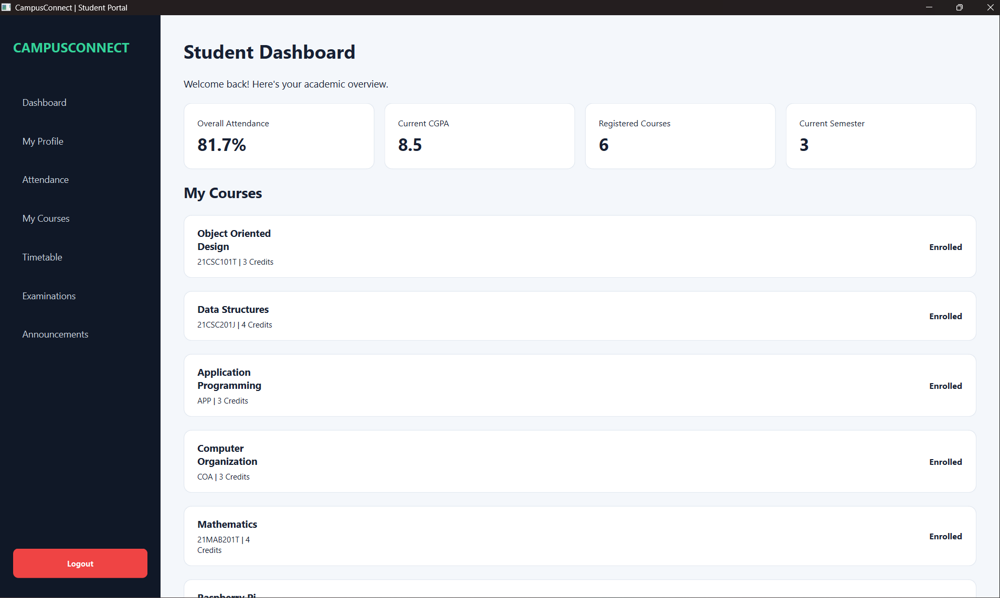
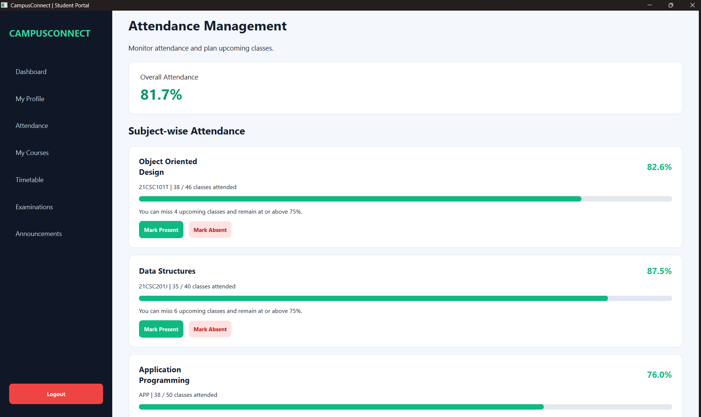
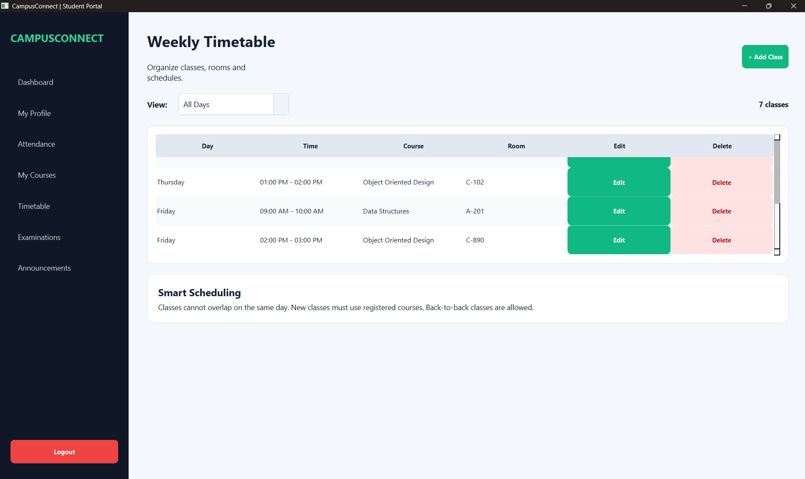
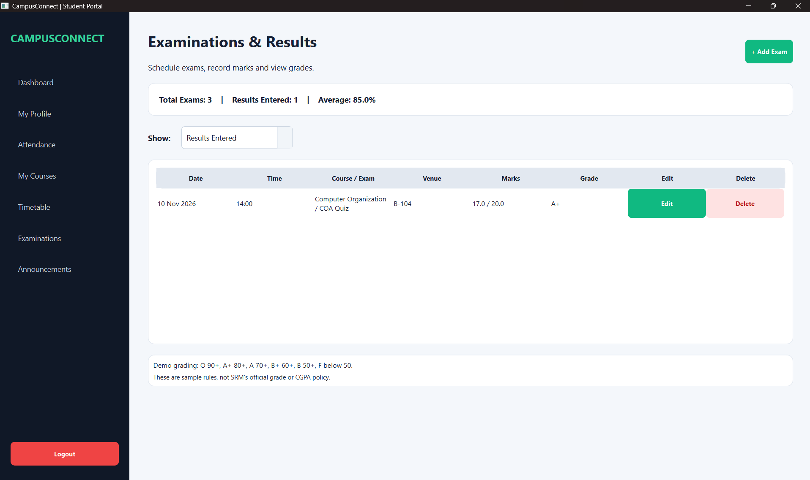
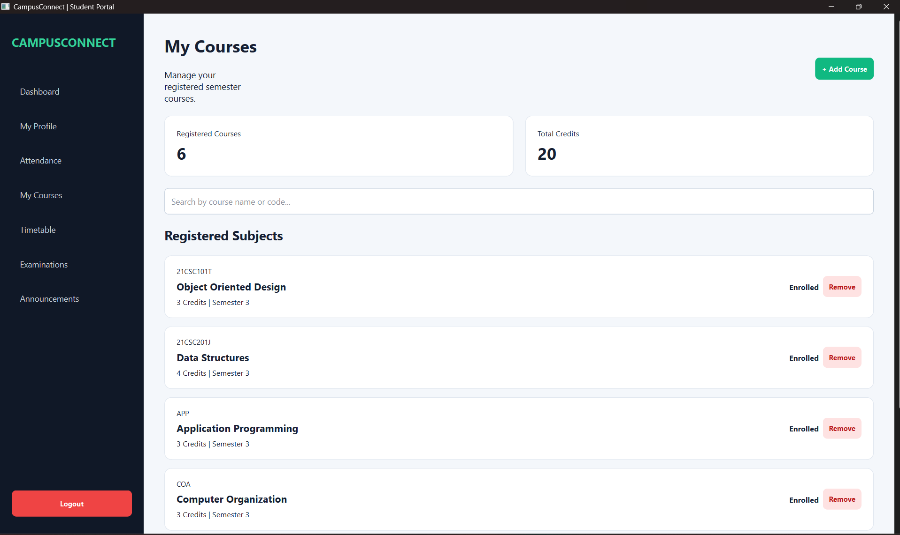
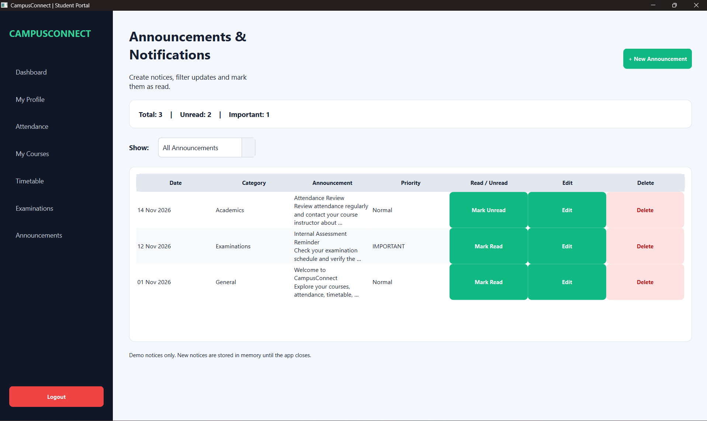

# CampusConnect — Student Management System

A desktop student-management application built with **C++**, **Qt Widgets**, and **CMake**. CampusConnect brings common academic tasks into one interface, with local JSON storage so records remain available after restarting the application.

> **Project status:** Academic demonstration project. The application is designed for local use; it is not connected to SRM University systems.

## Features

| Module | Capabilities |
| --- | --- |
| Login & Logout | Demo student login and logout |
| Dashboard | Overview of academic information and recent announcements |
| My Profile | Student profile display |
| Attendance | Track present/absent classes, calculate attendance percentages, and highlight the 75% threshold |
| My Courses | Add, remove, and search courses; calculate total credits |
| Weekly Timetable | Add, edit, delete, and filter classes; detect schedule clashes |
| Examinations & Results | Schedule exams, enter marks, and calculate percentages and demonstration grades |
| Announcements & Notifications | Create and manage announcements, priorities, and read/unread status |
| Persistent Storage | Save and reload local records using JSON |

## Screenshots

Add screenshots to the `screenshots/` folder using the filenames below. Until you add the images, these links are placeholders.

| Dashboard | Attendance |
| --- | --- |
|  |  |

| Timetable | Examinations |
| --- | --- |
|  |  |

| Courses | Announcements |
| --- | --- |
|  |  |

## Technology Stack

- **Language:** C++
- **GUI:** Qt Widgets (Qt 6)
- **Build system:** CMake
- **Development environment:** Qt Creator
- **Storage:** Local JSON file
- **Tested development platform:** Windows

## Getting Started

### Prerequisites

- Qt Creator with a compatible **Qt 6 Widgets** development kit
- CMake and a C++ compiler compatible with the selected Qt kit (for example, MinGW)
- Git (optional, for cloning)

### Build and Run in Qt Creator

1. Clone this repository, or download it using **Code → Download ZIP**:

   ```bash
   git clone https://github.com/ananya-gif-hub/CampusConnect-Student-Management-System.git
   ```

2. Open **Qt Creator**.
3. Select **File → Open File or Project** and open `CMakeLists.txt` from the repository folder.
4. Choose a configured Qt 6 desktop kit and let CMake configure the project.
5. Build the project (`Ctrl+B`).
6. Run the application (`Ctrl+R`).

### Demo Login

```text
Username: student
Password: 1234
```

**Security note:** These credentials are for a classroom demonstration only. This project does not provide production-grade authentication or account security.

## Data Storage

CampusConnect stores course, attendance, timetable, examination, and announcement records locally in JSON format. Records are restored on subsequent launches. The data file is machine-local and is not intended to be committed to GitHub.

## Project Structure

```text
CampusConnect/
├── CMakeLists.txt       # CMake build configuration
├── main.cpp             # Application entry point
├── mainwindow.h         # Main window declarations
├── mainwindow.cpp       # UI and application logic
├── mainwindow.ui        # Qt Designer form
├── student.h            # Student-related declarations
├── screenshots/         # Screenshots (add later)
├── .gitignore           # Local and generated files excluded from Git
└── README.md            # Project documentation
```

## Limitations and Future Improvements

- Local demonstration login only; no production-ready authentication
- No cloud sync or multi-user backend
- Grade thresholds are demonstration rules, **not official SRM University grade or CGPA calculations**
- Future improvements could include role-based access, secure login, a database backend, and exportable reports

## License

No license has been selected yet. All rights are reserved unless a license is added.
